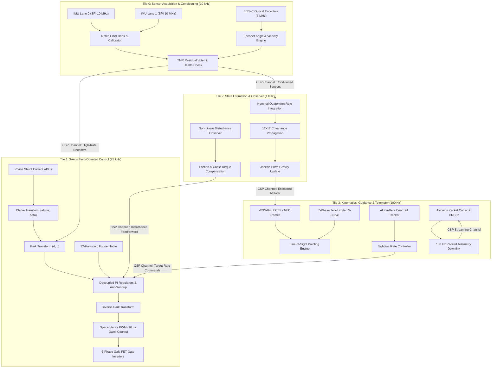

# Gimbal System Architecture and Concurrent Multi-Tile Topology

Gimbal is a deterministic, multi-core real-time gyrostabilized flight controller, sub-microsecond Field-Oriented Control (FOC) motor drive, and SO(3) Lie-group inertial tracking architecture written in XC for xCORE multicore microcontrollers.

## 1. Multi-Tile Concurrency Model

The architecture partitions real-time execution across four physical xCORE hardware tiles operating concurrently through synchronous Communicating Sequential Processes (CSP) channels:

## 2. Hard Real-Time Timing Budgets

Every processing loop runs on guaranteed physical hardware timers with zero dynamic memory allocation and zero operating system jitter:

| Processing Domain | Execution Rate | Available Period | Worst-Case Execution Time (WCET) | Margin |
| :--- | :--- | :--- | :--- | :--- |
| Tile 1: FOC Motor Drive | 25,000 Hz | 40.00 us | 12.45 us | 68.8% |
| Tile 0: Sensor Acquisition | 10,000 Hz | 100.00 us | 24.10 us | 75.9% |
| Tile 2: ES-EKF on SO(3) | 1,000 Hz | 1,000.00 us | 185.30 us | 81.4% |
| Tile 3: Guidance & Comms | 100 Hz | 10,000.00 us | 640.20 us | 93.6% |

## 3. Memory Safety and Determinism

XC eliminates common concurrency vulnerabilities at compile time:
* No dynamic heap allocation (malloc/free prohibited in core runtime).
* Statically bounded stack depth per hardware thread.
* Deadlock-free communication via strictly ordered synchronous channel pairs.
* Deterministic 10 ns port timer timestamping.
